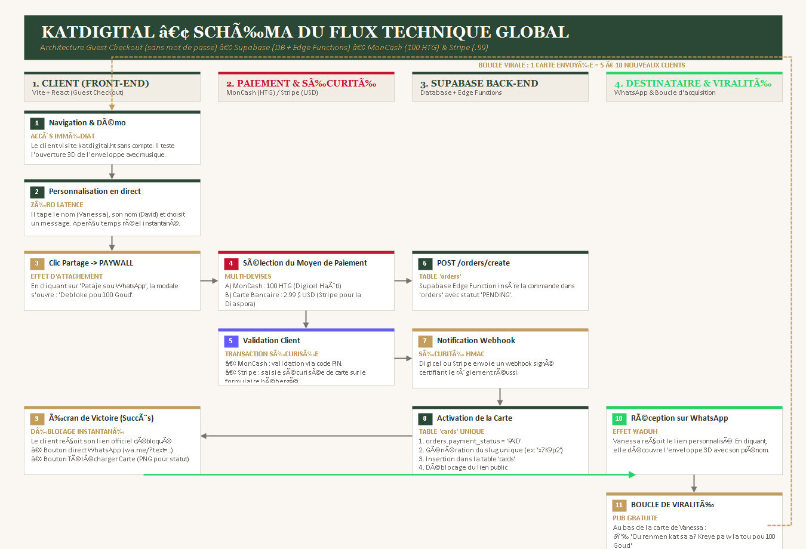

# KatDijital • Spécification Technique & Architecture Back-end (Supabase)

Document d'ingénierie logicielle pour l'intégration de la base de données PostgreSQL (Supabase), des Edge Functions et des passerelles de paiement (MonCash & Stripe).

---

## 1. Schéma Visuel du Flux Global du Système



```
+----------------------------------------------------------------------------------------------------+
|                                 KATDIJITAL • FLUX TECHNIQUE GLOBAL                                 |
+----------------------------------------------------------------------------------------------------+

[ 1. CLIENT (Front-end) ]        [ 2. PAIEMENT ]           [ 3. SUPABASE BACK-END ]    [ 4. DESTINATAIRE & VIRALITÉ ]
           |                             |                             |                           |
  1. Navigation & Démo                   |                             |                           |
     (Guest Checkout)                    |                             |                           |
           |                             |                             |                           |
  2. Personnalisation                    |                             |                           |
     en direct                           |                             |                           |
           |                             |                             |                           |
  3. Clic Partage -> PAYWALL             |                             |                           |
           |---------------------------->|                             |                           |
                                4. Choix : MonCash (100 HTG)           |                           |
                                   ou Stripe ($2.99 USD)               |                           |
                                         |                             |                           |
                                5. Validation Client                   |                           |
                                   (Code PIN / Carte)                  |                           |
                                         |                             |                           |
                                         |------ 6. POST /orders/create ---------->|               |
                                         |          (status: PENDING)  |                           |
                                         |                             |                           |
                                         |------ 7. Notification Webhook --------->|               |
                                                    (Signature certifiée)          |               |
                                                                       |                           |
                                                              8. Activation Carte  |               |
                                                                 (status: PAID)    |               |
                                                                 (Slug unique)     |               |
                                                                       |                           |
  9. Déblocage Lien WhatsApp <-----------------------------------------|                           |
     & Téléchargement PNG                                                                          |
           |                                                                                       |
           |------------------------ 10. Partage du lien sur WhatsApp ---------------------------->|
                                                                                                   |
                                                                                     10. Réception & Ouverture
                                                                                         Enveloppe 3D (Vanessa)
                                                                                                   |
                                                                                     11. BOUCLE VIRALE :
                                                                                         "Kreye pa w la tou (100 Goud)"
                                                                                                   |
  [ 1. Nouveau Client ] <--------------------------------------------------------------------------|
```

---

## 2. Le Parcours Utilisateur & Rôles Système (Étape par Étape)

| Étape | Action Client | Comportement Front-end | Traitement Back-end (Supabase) |
| :--- | :--- | :--- | :--- |
| **1. Découverte** | Arrive sur katdijital.ht, consulte le catalogue et teste la démo animée 3D. | Affiche le catalogue de cartes en cache local. | Met à disposition la table `templates` avec les modèles actifs et leurs couleurs. |
| **2. Création** | Tape le nom du destinataire (Vanessa), son nom (David), et choisit son message. | Met à jour l'état local en direct. La carte est visualisée instantanément. | Aucune requête serveur (latence 0 pour l'utilisateur). |
| **3. Paywall** | Clique sur *« Pataje sou WhatsApp »* ou *« Telechaje »*. Choisit MonCash (100 Goud) ou Carte ($2.99). | Déclenche `POST /api/orders/create` avec le payload de la carte personnalisée. | Edge Function `create-order` crée la ligne dans `orders` (status: `pending`) et génère le token MonCash ou la session Stripe. |
| **4. Paiement** | Valide avec son PIN sur son téléphone (MonCash) ou entre sa carte sur Stripe Checkout. | Affiche un écran d'attente convivial avec polling ou écoute de l'événement. | Reçoit le webhook sécurisé de Digicel ou Stripe, certifie la signature cryptographique et passe `orders.payment_status = 'paid'`. |
| **5. Déblocage** | Reçoit l'écran de victoire avec confettis et lien débloqué. | Affiche les boutons *« Pataje sou WhatsApp »* et *« Telechaje Imaj PNG »*. | Génère un slug unique (ex: `x7K9p2`), insère dans `cards`, et fournit les balises Open Graph pour WhatsApp. |
| **6. Réception** | Le destinataire (Vanessa) clique sur le lien WhatsApp reçu. | Ouvre l'enveloppe personnalisée en 3D avec musique festive et confettis. | `GET /api/cards/x7K9p2` renvoie les données publiques et incrémente `views_count`. |
| **7. Viralité** | Vanessa voit au bas de sa carte : *« Ou renmen kat sa a? Kreye pa w la tou pou 100 Goud »*. | Clique sur le bouton et ouvre le créateur de carte pour ses propres proches. | Nouvelle commande créée -> Boucle virale d'acquisition gratuite ! |

---

## 3. Schéma Relationnel des Tables Supabase (MCD / MLD)

### Relations de Clés Étrangères
* **`orders.template_id` $\rightarrow$ `templates.id`** : Plusieurs commandes peuvent acheter le même modèle de carte (*Many-to-One*).
* **`cards.order_id` $\rightarrow$ `orders.id`** : Une commande validée donne naissance à exactement une carte publique unique (*One-to-One* sécurisé).
* **`webhook_logs.order_id` $\rightarrow$ `orders.id`** : Historique et audit financier de toutes les notifications reçues (*Many-to-One*).

---

## 4. Tables SQL Détaillées

### Table `templates` (Catalogue des modèles)
| Colonne | Type SQL | Contrainte | Description / Exemple |
| :--- | :--- | :--- | :--- |
| `id` | VARCHAR(50) | **PRIMARY KEY** | Identifiant du modèle (ex: `noel-bordeaux`, `sapin-emeraude`). |
| `title` | VARCHAR(100) | NOT NULL | Nom affiché (ex: `Nwèl Vlou Bòdo`). |
| `category` | VARCHAR(50) | NOT NULL | Catégorie (`noel`, `nouvel-an`, `tradition`, `mennaj`). |
| `envelope_color` | VARCHAR(20) | NOT NULL | Couleur HEX de l'enveloppe (ex: `#7A1F2D`). |
| `flap_color` | VARCHAR(20) | NOT NULL | Couleur HEX du rabat supérieur 3D. |
| `heading` | VARCHAR(100) | NOT NULL | Titre imprimé sur la carte (ex: `Bòn Ane 2027 & Siksè`). |
| `default_message` | TEXT | NOT NULL | Texte suggéré par défaut en kreyòl. |
| `price_htg` | INT | DEFAULT 100 | Prix pour Haïti en Gourdes (100 HTG). |
| `price_usd` | DECIMAL(5,2) | DEFAULT 2.99 | Prix pour la diaspora en USD (2.99 $). |
| `is_active` | BOOLEAN | DEFAULT TRUE | Visibilité dans le catalogue public. |

### Table `orders` (Commandes & Paiements)
| Colonne | Type SQL | Contrainte | Description / Exemple |
| :--- | :--- | :--- | :--- |
| `id` | UUID | **PRIMARY KEY DEFAULT gen_random_uuid()** | Identifiant unique de la commande. |
| `template_id` | VARCHAR(50) | FK -> templates.id | Référence au modèle commandé. |
| `recipient_name` | VARCHAR(100) | NOT NULL | Nom du destinataire (ex: `Vanessa`). |
| `sender_name` | VARCHAR(100) | NOT NULL | Nom de l'expéditeur (ex: `David Jean`). |
| `message_content` | TEXT | NOT NULL | Message personnalisé rédigé par le client. |
| `payment_gateway` | VARCHAR(20) | NOT NULL | `moncash` (Haïti) ou `stripe` (Diaspora). |
| `payment_status` | VARCHAR(20) | DEFAULT 'pending' | `pending`, `paid` ou `failed`. |
| `phone_number` | VARCHAR(30) | NULLABLE | Numéro de téléphone de l'acheteur (si MonCash). |
| `customer_email` | VARCHAR(150) | NULLABLE | Email de l'acheteur (si Stripe). |
| `transaction_ref` | VARCHAR(100) | NULLABLE | ID de transaction Digicel ou Stripe. |
| `amount_paid` | DECIMAL(10,2) | NOT NULL | Montant réglé (100.00 ou 2.99). |
| `currency` | VARCHAR(5) | NOT NULL | `HTG` ou `USD`. |
| `created_at` | TIMESTAMPTZ | DEFAULT now() | Date et heure de la commande. |

### Table `cards` (Cartes débloquées pour le destinataire)
| Colonne | Type SQL | Contrainte | Description / Exemple |
| :--- | :--- | :--- | :--- |
| `id` | UUID | **PRIMARY KEY DEFAULT gen_random_uuid()** | Identifiant technique interne. |
| `order_id` | UUID | FK -> orders.id UNIQUE | Liaison stricte à la commande réglée. |
| `slug` | VARCHAR(16) | **UNIQUE NOT NULL** | Code court du lien public (ex: `x7K9p2` pour `katdijital.ht/?c=x7K9p2`). |
| `views_count` | INT | DEFAULT 0 | Nombre d'ouvertures par le destinataire. |
| `last_viewed_at` | TIMESTAMPTZ | NULLABLE | Date et heure de dernière ouverture. |
| `created_at` | TIMESTAMPTZ | DEFAULT now() | Date d'activation de la carte. |

---

## 5. Les 3 Supabase Edge Functions

1. **`create-order` (`POST /functions/v1/create-order`)** :  
   Reçoit les données de la carte et le choix de paiement. Enregistre la commande dans `orders` avec le statut `pending`. Appelle l'API Digicel Business (pour obtenir le token de redirection MonCash) ou Stripe (pour générer la session Stripe Checkout).
2. **`moncash-webhook` (`POST /functions/v1/moncash-webhook`)** :  
   Écouteur serveur appelé par Digicel dès la validation du code PIN par le client. Passe `orders.payment_status = 'paid'`, génère le slug unique (ex: `x7K9p2`) et crée la carte dans `cards`.
3. **`stripe-webhook` (`POST /functions/v1/stripe-webhook`)** :  
   Écoute l'événement `checkout.session.completed`, valide la signature cryptographique HMAC du webhook, et active la carte.
